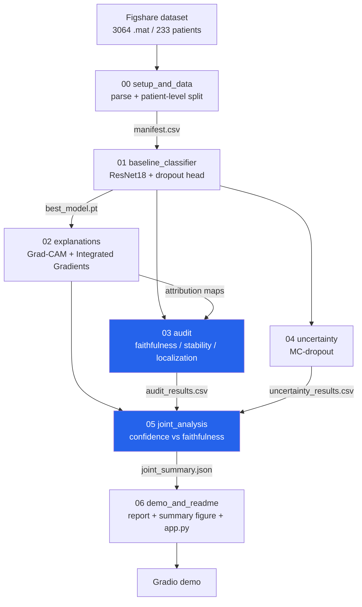

# Can You Trust the Heatmap?
### A Quantitative Audit of Explainable AI for Brain Tumor MRI Classification

A brain tumor MRI classifier (Figshare dataset — glioma / meningioma / pituitary)
paired with a **quantitative audit of its explanations** — testing whether
Grad-CAM and Integrated-Gradients heatmaps can actually be *trusted*, not just
whether they look convincing — plus an MC-dropout uncertainty layer and a joint
analysis linking model confidence to explanation trustworthiness.

> Most work on this dataset stops at "we classified tumors and here's a pretty
> Grad-CAM." This project asks the harder question: **when the model is
> confident, is its explanation also faithful, stable, and correctly localized —
> and does its uncertainty flag the cases where the explanation can't be
> trusted?**

---

## Pipeline

Seven notebooks, run in order, each consuming the previous ones' committed
outputs. An **MD5 lineage check** at every stage guarantees that the explanations,
audit, and uncertainty all describe the *same* trained model on the *same*
patient-level data split.



The two highlighted stages — the **audit** and the **joint analysis** — are the
core contribution.

---

## Results

> ⚠️ **Numbers pending the first full Kaggle run.** This repository ships the
> complete, reproducible pipeline; the headline metrics below are filled in from
> the notebooks' own summary outputs (`test_metrics.json`, `audit_summary.json`,
> `uncertainty_summary.json`, `joint_summary.json`) once the chain has been run
> end-to-end. No numbers here are hand-typed or estimated.

| Metric | Value |
|---|---|
| Test accuracy (patient-level split) | _pending_ |
| Macro-F1 | _pending_ |
| Grad-CAM vs IG faithfulness (deletion/insertion AUC, vs random control) | _pending_ |
| Explanation stability under label-preserving perturbations | _pending_ |
| Localization vs ground-truth tumor mask (IoU / Dice / pointing game) | _pending_ |
| MC-dropout calibration (ECE) & error-detection AUROC | _pending_ |
| Confidence × faithfulness: "confidently wrong" danger-cell count | _pending_ |

---

## What each axis measures

- **Faithfulness** — if a heatmap highlights the pixels that truly drive the
  prediction, deleting them should collapse the model's confidence (and inserting
  them into a blurred image should restore it). Scored as deletion/insertion AUC
  **against a random-map control**, so the metric reflects the explanation, not
  just the image's base confidence.
- **Stability** — a trustworthy explanation shouldn't swing wildly under a tiny,
  label-preserving change to the input. Measured by recomputing the heatmap under
  small rotations / brightness shifts (geometric maps are warped back before
  comparison) and correlating with the original.
- **Localization** — does the heatmap actually land on the tumor? Scored with
  IoU / Dice / pointing-game / energy against the ground-truth tumor mask.
- **Uncertainty** — MC-dropout (dropout left on at inference, BatchNorm frozen;
  30 stochastic passes) gives predictive entropy and mutual information, plus
  calibration and whether uncertainty separates right from wrong predictions.
- **Joint analysis** — ties it together: are confident predictions also the
  well-explained ones, and does uncertainty flag the untrustworthy heatmaps? Uses
  a random-control-corrected faithfulness score to avoid the circularity of
  correlating confidence against a confidence-driven metric.

---

## Repository structure

```
brain-tumor-xai-audit/
├── notebooks/            # the 7-stage pipeline (run in order 00 -> 06)
├── src/                  # reusable package, extracted from the notebooks
│   ├── data/             # .mat parsing, Dataset, transforms
│   ├── models/           # ResNet18 + dropout head (MC-dropout ready)
│   ├── explain/          # Grad-CAM, Integrated Gradients
│   ├── audit/            # faithfulness, stability, localization metrics
│   ├── uncertainty/      # MC-dropout + uncertainty metrics
│   ├── joint/            # confidence x faithfulness statistics
│   └── demo/             # single-image inference for the app
├── configs/              # YAML hyperparameters / paths
├── tests/                # unit tests for the audit & uncertainty metrics
├── results/              # figures + summary JSONs (populated by the run)
└── docs/                 # end-to-end pipeline report
```

---

## Reproduce it on Kaggle

The pipeline is built for Kaggle (free GPU). Run the notebooks in order; for each
one, attach the committed Output of the notebooks it depends on as inputs, then
**Save Version → Save & Run All (Commit)** so its outputs persist for the next.

| Notebook | Attach as input | Accelerator |
|---|---|---|
| `00_setup_and_data` | — (downloads the dataset; Internet **On**) | None |
| `01_baseline_classifier` | 00 | **GPU** |
| `02_explanations` | 00, 01 | **GPU** |
| `03_audit` | 00, 01, 02 | **GPU** |
| `04_uncertainty` | 00, 01 | **GPU** |
| `05_joint_analysis` | 00, 02, 03, 04 | None |
| `06_demo_and_readme` | 00, 01, 02, 03, 04, 05 | None |

**Lineage note:** every stage verifies the upstream checkpoint/manifest MD5s, so
re-running any notebook means re-running everything downstream of it.

### Local use of the package

```bash
pip install -r requirements.txt
pytest tests/        # run the audit & uncertainty metric tests
```

---

## Demo

`src/demo/inference.py` (wrapped by the Gradio `app.py` the final notebook
generates) takes an MRI slice and returns the prediction, Grad-CAM + IG overlays,
MC-dropout uncertainty, and an automated **trust flag** that warns when a
confident prediction rests on an untrustworthy explanation. Deployable to
Hugging Face Spaces.

---

## Limitations

Stated plainly, because the project is about honesty: last-layer MC-dropout (not
full-network epistemic uncertainty); a single architecture (ResNet18) and a single
dataset; sparse Grad-CAM maps get an artificial stability boost from empty
background under SSIM; the deletion baseline introduces a mild bias; and
correlation between confidence and faithfulness is not causation.

---

## Dataset

Cheng, Jun, et al. *"Enhanced Performance of Brain Tumor Classification via Tumor
Region Augmentation and Partition."* PLoS ONE 10.10 (2015).
<https://figshare.com/articles/dataset/brain_tumor_dataset/1512427> (CC BY 4.0) —
3064 T1-weighted contrast-enhanced MRI slices from 233 patients, 3 tumor classes,
with a manually delineated tumor mask per image.

### Why patient-level splitting matters

Each patient contributes multiple near-identical slices sharing one label.
Splitting by image (not patient) leaks near-duplicate slices across train/test and
silently inflates accuracy. This project splits and verifies by `patient_id`.

---

## License

Code released under the MIT License (see [LICENSE](LICENSE)). The dataset is the
authors' under CC BY 4.0, as cited above.

---

<sub>Pipeline code generated with Claude (Anthropic) via Claude Code, directed and reviewed by the author.</sub>
